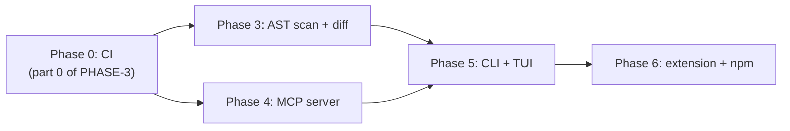

# AGENTS.md — working guide for OpenTaste

Read this before touching the repository. [SPEC.md](SPEC.md) says *what* OpenTaste
is, [PLAN.md](PLAN.md) explains *why* the remaining work is ordered the way it is,
and `plans/PHASE-*.md` are the executable task lists.

> **Do not hand-edit anything between `<!-- OPENTASTE:START -->` and
> `<!-- OPENTASTE:END -->` in this file.** `taste sync` owns that region and will
> overwrite it. Everything outside the markers is yours and is preserved.

---

## Repository layout

```text
crates/taste-core/   finished apart from ast/ and diff/ (phase 3)
crates/taste-mcp/    stub: only MCP_PROTOCOL_VERSION exists (phase 4)
crates/taste-cli/    stub: main.rs prints the version (phase 5)
packages/            does not exist yet (phase 6)
plans/               one file per phase, with a status you keep current
```

Current baseline on `main`: **148 tests passing**, `cargo clippy --workspace
--all-targets -- -D warnings` clean, `cargo fmt --all --check` clean. Do not
regress it.

## The four entry points

Almost every integration goes through `RuleStore`. Prefer these over reaching
into `JsonStore` or `SqliteStore` directly, because `RuleStore` is what holds the
advisory lock and keeps the JSON file and the candidate cache in agreement.

| Call | Purpose |
| --- | --- |
| `record_observation(Observation) -> Outcome` | The only way a rule is created, reinforced or promoted |
| `rules_for_file(path) -> Vec<TasteRule>` | Active rules whose scope glob matches a file |
| `sync() -> SyncReport` | Compile active rules into every editor target |
| `apply_contradiction(id) -> bool` | Decay, and possibly demote, a rule worked against |

Also available: `promote_candidate`, `set_enabled`, `delete_rule`,
`set_project_context`, `candidate_rules`, `candidates()` (for
`upsert_snapshot` / `get_snapshot`), and `storage::validate_scope` for globs
arriving from outside the codebase.

## Plan file workflow

Each phase has one file in `plans/`. The header of every file looks like this:

```markdown
# Phase N: <title>

**Status:** pending
```

Rules for keeping it honest:

1. **`pending`** — nothing started. This is the initial state of every file.
2. **`ongoing`** — set this the moment you begin the first task in the file, in
   the same change as your first code edit. Never work on a `pending` phase.
3. **`completed`** — set this only after every gate in the file's *Definition of
   done* passes. A phase with a failing gate stays `ongoing`.

Tick the `- [ ]` task boxes as you land each piece. If you discover the plan is
wrong, edit the plan in the same change that proves it wrong — a stale plan is
worse than no plan, because the next agent will trust it.

## Phase dependencies



| Phase | File | Blocked by | Blocks |
| --- | --- | --- | --- |
| 0 — CI | [plans/PHASE-3.md](plans/PHASE-3.md) part 0 | nothing | 3, 4, 5, 6 |
| 3 — AST scanner, structural diff | [plans/PHASE-3.md](plans/PHASE-3.md) | 0 | 5, 6 |
| 4 — stdio MCP server | [plans/PHASE-4.md](plans/PHASE-4.md) | 0 | 5 |
| 5 — CLI and TUI | [plans/PHASE-5.md](plans/PHASE-5.md) | 0, 3, 4 | 6 |
| 6 — extension and npm wrapper | [plans/PHASE-6.md](plans/PHASE-6.md) | 0, 3, 5 | nothing |

Phase 0 lives inside the phase 3 file because it has to happen before any other
work, and phase 3 is the first numbered file. **If you start with phase 4
instead, execute part 0 of the phase 3 file first anyway.** Phases 3 and 4 do not
depend on each other and may be built in either order or in parallel.

Two artefacts cross a phase boundary and must not be changed unilaterally:

- **The `learn-delta` stdin/stdout JSON contract**, fixed in
  [plans/PHASE-5.md](plans/PHASE-5.md) step 3 and consumed by
  [plans/PHASE-6.md](plans/PHASE-6.md) step 3. Change it in both files, or not at
  all.
- **The set of transpiler target paths**, owned by `config::Paths`. Phase 6's
  delta tracker must exclude exactly those paths, so it reads them from one list
  rather than hardcoding its own.

## Standing engineering rules

These apply to every phase and are the gate for calling one done.

- `cargo fmt --all --check`, `cargo clippy --workspace --all-targets -- -D
  warnings` and `cargo test --workspace` all clean. No exceptions, no `#[allow]`
  added to silence a real finding.
- **A wrong rule is worse than a missing rule.** A bad rule actively degrades
  every AI edit in the project, while a missing one costs nothing. When a
  detector is ambiguous, do not emit.
- **Never write to a developer-owned file without preserving what was there.**
  `transpiler/marker.rs` sets the pattern: read, splice between markers, write
  atomically, and delete a file only if OpenTaste created all of it. `.gitignore`,
  `.cursor/mcp.json` and `.git/hooks/post-commit` in phase 5 must follow it.
- **Keep confidence arithmetic in `scorer/confidence.rs`.** Everything funnels
  through `models::round2`, which is what stops the git-tracked rule file from
  churning on float noise.
- **`taste-core` returns typed `Error`s and never `anyhow`.** Binaries wrap them.
- **Scope globs are validated, not trusted.** Use `storage::validate_scope` on
  any glob that did not come from this codebase.
- Analysis code stays pure and per-file so it is trivially parallel: the
  statistical analyzers count, and a single reviewable place decides.
- Tests name the behaviour they protect, not the function they call. Match the
  existing style in `crates/taste-core/tests/`.

## Commands

```bash
cargo fmt --all
cargo clippy --workspace --all-targets -- -D warnings
cargo test --workspace
cargo insta review   # after changing transpiler output
```

The toolchain floor is declared as `rust-version = "1.89"` in the workspace
`Cargo.toml`, because the advisory lock uses `std::fs::File::lock`. Do not use a
newer std API without raising that line and the MSRV job in CI together.
