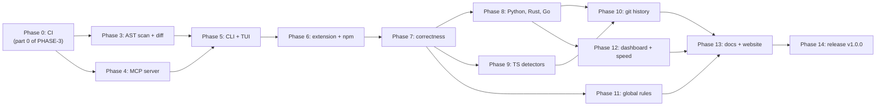

# AGENTS.md — working guide for OpenTaste

Read this before touching the repository. [SPEC.md](SPEC.md) says *what* OpenTaste
is, [PLAN.md](PLAN.md) explains *why* the remaining work is ordered the way it is,
and `plans/PHASE-*.md` are the executable task lists.

> **Do not hand-edit anything between `<!-- OPENTASTE:START -->` and
> `<!-- OPENTASTE:END -->` in this file.** `taste sync` owns that region and will
> overwrite it. Everything outside the markers is yours and is preserved.

---

## Repository layout

```text
crates/taste-core/   finished, including ast/ and diff/ (phase 3)
crates/taste-mcp/    stdio MCP server, finished (phase 4)
crates/taste-cli/    the `taste` binary and dashboard, finished (phase 5)
packages/            VS Code extension and the @opentaste/cli npm wrapper (phase 6)
plans/               one file per phase, with a status you keep current
```

Current baseline on `main`: **415 Rust tests and 40 TypeScript tests passing**
(`pnpm -r run test`), `cargo clippy --workspace
--all-targets -- -D warnings` clean, `cargo fmt --all --check` clean. Do not
regress it.

## The four entry points

Almost every integration goes through `RuleStore`. Prefer these over reaching
into `JsonStore` or `SqliteStore` directly, because `RuleStore` is what holds the
advisory lock and keeps the JSON file and the candidate cache in agreement.

| Call | Purpose |
| --- | --- |
| `record_observation(Observation) -> Outcome` | The only way a rule is created, reinforced or promoted |
| `rules_for_file(path) -> Vec<TasteRule>` | Active rules whose scope glob matches a file |
| `sync() -> SyncReport` | Compile active rules into every editor target |
| `apply_contradiction(id) -> bool` | Decay, and possibly demote, a rule worked against |

Also available: `promote_candidate`, `set_enabled`, `delete_rule`,
`set_project_context`, `candidate_rules`, `candidates()` (for
`upsert_snapshot` / `get_snapshot`), and `storage::validate_scope` for globs
arriving from outside the codebase.

## Branches

```text
feature/fix branch ──PR──▶ dev ──PR──▶ main ──tag v*──▶ release
```

- **`dev`** is the integration branch. Every feature or fix branch starts from
  `dev` and opens its pull request against `dev`. Before opening one, bring
  the branch up to date with `dev` so it is tested against everything else
  that is about to ship.
- **`main`** only receives pull requests from `dev`, when a release is ready.
  It is what users install from and what the website deploys.
- **Release tags (`v*`) are only ever cut on `main`.** `release.yml` publishes
  whatever commit a tag points at, so a tag on `dev` would publish unreleased
  work.
- CI runs on every pull request and on pushes to both `dev` and `main`. Never
  merge into either one on a red run.
- A fix that must reach `main` before the next release still goes through
  `dev`: merge it into `dev`, then open the `dev` → `main` pull request.

## Plan file workflow

Each phase has one file in `plans/`. The header of every file looks like this:

```markdown
# Phase N: <title>

**Status:** pending
```

Rules for keeping it honest:

1. **`pending`** — nothing started. This is the initial state of every file.
2. **`ongoing`** — set this the moment you begin the first task in the file, in
   the same change as your first code edit. Never work on a `pending` phase.
3. **`completed`** — set this only after every gate in the file's *Definition of
   done* passes. A phase with a failing gate stays `ongoing`.

Tick the `- [ ]` task boxes as you land each piece. If you discover the plan is
wrong, edit the plan in the same change that proves it wrong — a stale plan is
worse than no plan, because the next agent will trust it.

## Build and test one step at a time

**Every step of a phase ships with its own tests, and the three commands below
pass before you start the next step.** Do not build a whole phase and then test
it.

```bash
cargo fmt --all
cargo clippy --workspace --all-targets -- -D warnings
cargo test --workspace
```

This is not ceremony, and it is not about test count. It is the only way this
particular project stays correct, for three reasons specific to what OpenTaste
does:

1. **The layers feed each other.** A miscounted tally in an analyzer becomes a
   wrong ratio, which becomes a wrongly promoted rule, which becomes a bad
   instruction in `CLAUDE.md`. By the time you see the bad instruction you are
   four layers from the cause. Caught at its own step, it is a one-line fix.
2. **A wrong rule is worse than a missing rule**, and wrong rules are the
   failure mode untested detectors produce. They do not crash; they quietly
   degrade every AI edit in the project.
3. **The suite is the specification.** The existing tests are how phases 1
   and 2 stay trustworthy while phases 3 to 6 are built on top of them. Each
   step you add should leave that property intact.

So: write the test with the code, not after it. A step that cannot be tested
yet is a sign the step is too large or the seam is in the wrong place — the
`serve(reader, writer, store)` signature in [plans/PHASE-4.md](plans/PHASE-4.md)
and the terminal-free `App` state machine in [plans/PHASE-5.md](plans/PHASE-5.md)
are both there precisely so their steps are testable as they land.

The `Tests` step near the end of each plan file is **the complete list the phase
cannot ship without**, there so you can confirm nothing was skipped. It is not a
batch of work to leave until last.

Two things cannot be caught this way, which is why each plan file also carries a
manual gate: whether an inferred rule is one a human actually agrees with, and
whether the tool behaves in a real editor. Do not skip those either.

## Phase dependencies



| Phase | File | Blocked by | Blocks |
| --- | --- | --- | --- |
| 0 — CI | [plans/PHASE-3.md](plans/PHASE-3.md) part 0 | nothing | 3, 4, 5, 6 |
| 3 — AST scanner, structural diff | [plans/PHASE-3.md](plans/PHASE-3.md) | 0 | 5, 6 |
| 4 — stdio MCP server | [plans/PHASE-4.md](plans/PHASE-4.md) | 0 | 5 |
| 5 — CLI and TUI | [plans/PHASE-5.md](plans/PHASE-5.md) | 0, 3, 4 | 6 |
| 6 — extension and npm wrapper | [plans/PHASE-6.md](plans/PHASE-6.md) | 0, 3, 5 | 7 (its release gates move to 14) |
| 7 — correctness | [plans/PHASE-7.md](plans/PHASE-7.md) | 6 | 8, 9, 11 |
| 8 — Python, Rust, Go | [plans/PHASE-8.md](plans/PHASE-8.md) | 7 | 10, 12 |
| 9 — strict null, zod, DI | [plans/PHASE-9.md](plans/PHASE-9.md) | 7 | 10 |
| 10 — recent git history | [plans/PHASE-10.md](plans/PHASE-10.md) | 7, 8, 9 | 13 |
| 11 — cross-project rules | [plans/PHASE-11.md](plans/PHASE-11.md) | 7 | 13 |
| 12 — dashboard edit, highlighting, speed | [plans/PHASE-12.md](plans/PHASE-12.md) | 7 (steps 1–2), 8 (step 3) | 13 |
| 13 — docs and website | [plans/PHASE-13.md](plans/PHASE-13.md) | 8–12 | 14 |
| 14 — release v1.0.0 | [plans/PHASE-14.md](plans/PHASE-14.md) | 7–13 | nothing |

Phase 0 lives inside the phase 3 file because it has to happen before any other
work, and phase 3 is the first numbered file. **If you start with phase 4
instead, execute part 0 of the phase 3 file first anyway.** Phases 3 and 4 do not
depend on each other and may be built in either order or in parallel.

Phases 7 to 14 come from [plans/V1-AUDIT.md](plans/V1-AUDIT.md), and
[plans/V1-TRACEABILITY.md](plans/V1-TRACEABILITY.md) maps every SPEC.md claim
to the code or phase step that delivers it. Phases 8, 9 and 11 do not depend
on each other once phase 7 is in.

Two artefacts cross a phase boundary and must not be changed unilaterally:

- **The `learn-delta` stdin/stdout JSON contract**, fixed in
  [plans/PHASE-5.md](plans/PHASE-5.md) step 3 and consumed by
  [plans/PHASE-6.md](plans/PHASE-6.md) step 3. Change it in both files, or not at
  all.
- **The set of transpiler target paths**, owned by `config::Paths`. Phase 6's
  delta tracker must exclude exactly those paths, so it reads them from one list
  rather than hardcoding its own.

## Not deferred any more: v1.0 scope

**On 2026-10-30 the scope changed: nothing in SPEC.md is cut.** Every row in
the table below is planned for v1.0.0, along with the other gaps found by
[plans/V1-AUDIT.md](plans/V1-AUDIT.md), which orders the work into phases 7
to 12. The table stays because its *why* column records the risk each item
carries; read it before starting the phase that builds the item, and do not
build a weak version of one to tick it off.

| Item | Where it appears | Why it is deferred |
| --- | --- | --- |
| `~/.taste/global.db`, cross-project rules | SPEC.md sections 2, 4.3; `Paths::global_db()` | The path helper exists and compiles, but nothing reads or writes the file and no phase in PLAN.md claims it. Project-local rules are the whole value proposition; sharing taste across unrelated repositories is a separate feature with its own privacy questions. |
| Mining *recent git history* for patterns | SPEC.md section 1 | Phase 5's `taste learn --from-git-head` covers the last commit only, which is what the `post-commit` hook needs. Walking back through history multiplies the cost of a wrong detector across every commit ever made. |
| Strict-null-check and zod-schema detection | SPEC.md section 2 (`types.rs`) | Strict null checking is a `tsconfig.json` setting, not a per-file statistical signal. Zod detection is plausible but was not worth a detector in the first release. |
| Dependency-injection pattern detection | SPEC.md section 2 (`arch.rs`) | DI shape varies too much between frameworks to count reliably, and an unreliable count becomes a wrong rule. |
| A `taste` binary bundled in the extension | [plans/PHASE-6.md](plans/PHASE-6.md) step 3 | The extension finds `taste` from its setting, the workspace's `node_modules/.bin`, then `PATH`. Bundling means one VSIX per platform (`vsce package --target`); downloading one at run time would be the network call the npm wrapper refuses to make. |
| Control-flow flattening detector | SPEC.md section 5.2, item 5 | Planned last in [plans/PHASE-3.md](plans/PHASE-3.md) and explicitly droppable. It needs real tree-shape comparison and is the detector most likely to be confidently wrong. |

If you implement one, move the row out of this table and into the relevant plan
file in the same change.

## Standing engineering rules

These apply to every phase and are the gate for calling one done.

- `cargo fmt --all --check`, `cargo clippy --workspace --all-targets -- -D
  warnings` and `cargo test --workspace` all clean. No exceptions, no `#[allow]`
  added to silence a real finding.
- **Never start a phase on top of a red one.** A phase is finished when every
  item in its *Definition of done* passes, including the manual gate, and not
  before. SPEC.md section 10 asks for the same thing. Later phases build
  directly on earlier ones — phase 5 wraps phases 3 and 4, phase 6 wraps phase 5
  — so a defect carried across a phase boundary gets harder to locate with every
  layer added on top of it.
- **A wrong rule is worse than a missing rule.** A bad rule actively degrades
  every AI edit in the project, while a missing one costs nothing. When a
  detector is ambiguous, do not emit.
- **Never write to a developer-owned file without preserving what was there.**
  `transpiler/marker.rs` sets the pattern: read, splice between markers, write
  atomically, and delete a file only if OpenTaste created all of it. `.gitignore`,
  `.cursor/mcp.json` and `.git/hooks/post-commit` in phase 5 must follow it.
- **Keep confidence arithmetic in `scorer/confidence.rs`.** Everything funnels
  through `models::round2`, which is what stops the git-tracked rule file from
  churning on float noise.
- **`taste-core` returns typed `Error`s and never `anyhow`.** Binaries wrap them.
- **Scope globs are validated, not trusted.** Use `storage::validate_scope` on
  any glob that did not come from this codebase.
- Analysis code stays pure and per-file so it is trivially parallel: the
  statistical analyzers count, and a single reviewable place decides.
- Tests name the behaviour they protect, not the function they call. Match the
  existing style in `crates/taste-core/tests/`.

## Commands

```bash
cargo fmt --all
cargo clippy --workspace --all-targets -- -D warnings
cargo test --workspace
cargo insta review   # after changing transpiler output
corepack enable && pnpm install --frozen-lockfile
pnpm -r run typecheck
pnpm -r run test     # TASTE_BIN=target/debug/taste also runs the end-to-end test
```

The toolchain floor is declared as `rust-version = "1.90"` in the workspace
`Cargo.toml`. `std::fs::File::lock` stabilised in 1.89; the floor is 1.90
because `tree-sitter` 0.27 requires it. Do not use a newer std API without
raising that line and the MSRV job in CI together.
