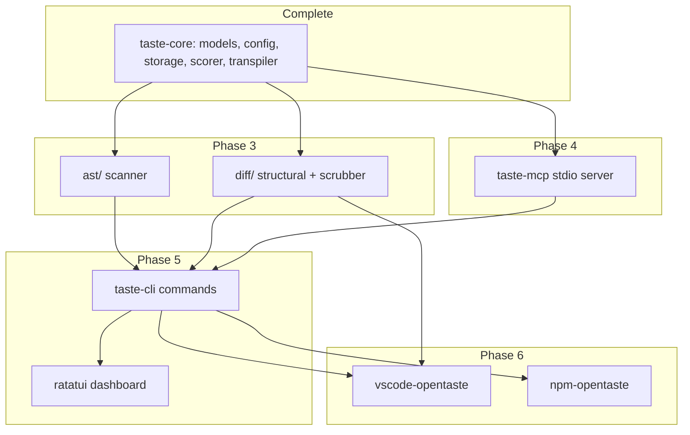

# OpenTaste Implementation Plan — Phases 3 to 6

Execution plan for the remaining work. [SPEC.md](SPEC.md) describes *what* OpenTaste
is; this file describes *how* and *in what order* to finish it, with the
decisions and hazards that only became visible once phases 1 and 2 were built.

Phases 1 and 2 are complete: 148 tests passing, `cargo clippy --workspace
--all-targets -- -D warnings` clean.

This file is the reasoning. The executable task lists, each carrying its own
status, live in `plans/`: [PHASE-3.md](plans/PHASE-3.md) (which also contains
phase 0), [PHASE-4.md](plans/PHASE-4.md), [PHASE-5.md](plans/PHASE-5.md) and
[PHASE-6.md](plans/PHASE-6.md). [AGENTS.md](AGENTS.md) describes how to work
through them and how the phases depend on one another.

---

## What already exists

Everything below builds on `taste-core`, which is finished apart from the AST
layer. Four entry points carry almost all of the integration surface:

| Call | Purpose | Used by |
| --- | --- | --- |
| `RuleStore::record_observation(Observation) -> Outcome` | The only way a rule is created, reinforced or promoted | Phases 3, 4, 5 |
| `RuleStore::rules_for_file(path) -> Vec<TasteRule>` | Active rules whose scope glob matches a file | Phase 4 |
| `RuleStore::sync() -> SyncReport` | Compile rules into all editor files | Phases 4, 5 |
| `RuleStore::apply_contradiction(id) -> bool` | Decay and demote a rule the developer worked against | Phases 3, 5 |

Also already available and currently unused: `SqliteStore::upsert_snapshot` /
`get_snapshot` (the `file_snapshots` table), which exists precisely so phase 3's
rescan can skip unchanged files. `TasteLock` is acquired inside every `RuleStore`
mutation, so no later phase needs to think about concurrency.

Phase 4 depends only on finished work, so it can be built before or in parallel
with phase 3. Phase 5 needs both. Phase 6 needs a working `taste` binary.

---

## Phase 0: continuous integration (do this first)

Not in the spec, but 148 tests protect nothing if no one runs them, and every
later phase adds more. This is roughly thirty minutes of work.

1. Create `.github/workflows/ci.yml` running `cargo fmt --all --check`,
   `cargo clippy --workspace --all-targets -- -D warnings` and
   `cargo test --workspace` on Linux, macOS and Windows stable.
2. Add `Swatinem/rust-cache` so the `rusqlite` bundled SQLite build is not
   recompiled on every run.
3. Make the first commit. The repository is `git init`-ed on `main` but nothing
   is committed yet.

Windows matters more than usual here: the marker injector has CRLF handling and
the scope matcher normalises backslashes, and neither has ever run on Windows.

**Gate:** all three jobs green.

---

## Phase 3: AST cold-start scanner and structural diff engine

The largest and least certain phase. Everything else is plumbing around it.

### Dependency note (verified, not assumed)

The compatibility risk flagged at the end of phase 2 is resolved. `tree-sitter`
0.27 works with the current 0.23-series grammar crates: all four report ABI 14
and parse correctly. Entry points are
`tree_sitter_typescript::LANGUAGE_TYPESCRIPT`, `LANGUAGE_TSX`,
`tree_sitter_python::LANGUAGE`, `tree_sitter_rust::LANGUAGE` and
`tree_sitter_go::LANGUAGE`, each converted with `.into()`.

Add to `crates/taste-core/Cargo.toml`: `tree-sitter`, `tree-sitter-typescript`,
`tree-sitter-python`, `tree-sitter-rust`, `tree-sitter-go`, `ignore`, `rayon`,
`similar`. All are already declared in `[workspace.dependencies]` except
`tree-sitter-go`, which needs adding there.

### Step 1: `ast/parser.rs` — the multi-language wrapper

Create `SupportedLanguage` (TypeScript, Tsx, JavaScript, Python, Rust, Go) with
detection from file extension, and a parser wrapper around it.

**Hazard:** `tree_sitter::Parser` is not `Sync` and cannot be shared across
threads. Do not try to put one behind an `Arc`. Give each worker thread its own
via `thread_local!`, built lazily per language.

Pair this with `content_hash(bytes) -> String` using the `sha2` dependency that
is already present, since step 3 needs it.

### Step 2: `ast/analyzers/` — statistical detectors

Four modules per SPEC.md section 2: `imports.rs` (alias versus relative, named
versus default), `types.rs` (`interface` versus `type`), `functions.rs` (arrow
versus declaration, guard clauses) and `arch.rs` (custom decorators, custom
error classes).

**Key decision: analyzers count, they do not decide.** Each returns a `Tally` of
raw observations, never a rule. A separate `ast/promote.rs` converts tallies into
`Observation`s only where the ratio is at least 0.80 with support from at least
10 files, calling `Observation::with_confidence(ratio)`.

This matters for three reasons: per-file analysis stays pure and therefore
trivially parallel; the threshold policy lives in one reviewable place; and the
tallies themselves are what `taste status` should display, so a developer can see
*why* a rule was inferred.

**Recommendation: write the detectors as `tree_sitter::Query` patterns**, not
hand-rolled cursor walks. An S-expression query is a few lines, is readable by
someone who has never seen the file, and is far less likely to miss a node shape
than a manual recursion. Reserve manual walking for the control-flow analysis in
step 5, where queries genuinely cannot express the shape.

### Step 3: `ast/scan.rs` — the parallel repository walk

**Key decision: collect paths serially, then analyse in parallel.** `ignore`'s
`build_parallel()` uses its own thread pool with a callback API that does not
compose with rayon's `fold`/`reduce`, forcing a `Mutex` around the accumulator.
Walking with the serial `ignore::Walk` and then driving `rayon::par_iter` over
the collected paths uses both crates honestly, needs no lock, and the walk itself
is not the bottleneck. Measured times are recorded in SPEC.md section 1.

Wire up incremental rescanning here using `SqliteStore::get_snapshot`: skip any
file whose content hash is unchanged since the last scan, and
`upsert_snapshot` for the rest. This is why that table was built in phase 1.

Then detect the stack for `ProjectContext::detected_stack` by reading
`package.json`, `Cargo.toml`, `pyproject.toml` and `go.mod`, and record it with
`RuleStore::set_project_context`.

### Step 4: `diff/scrubber.rs` — before the diff engine, not after

Build the scrubber **first**. The structural detectors in step 5 produce
`anti_pattern` and `preferred_pattern` snippets that get committed to
`.taste/rules.json`, and a leaked credential in a git-tracked file is the worst
failure this project can have. Writing the scrubber second means a window where
the unsafe path exists.

Per SPEC.md section 5.3: redact Shannon entropy above 4.5 on tokens longer than
16 characters, plus pattern matches for AWS keys, bearer tokens, private key
headers and `.env` assignments.

**Hazard: entropy alone will produce false positives** on legitimate code —
long hyphenated import paths, UUIDs in test fixtures, base64 asset data. Two
mitigations: only consider the *contents of string literals* rather than
identifiers or paths, which tree-sitter already identifies precisely; and keep an
allowlist of low-risk shapes (bare UUIDs, semver strings, hex colours). Redacting
an identifier would destroy the snippet's usefulness as an example, which is the
entire reason it is stored.

### Step 5: `diff/structural.rs` — the seven detectors

A `Detector` trait, each implementation taking `(before_tree, before_src,
after_tree, after_src)` and returning `Option<Observation>`.

**Recommendation: ship in two waves.** SPEC.md section 5.2 lists seven detectors
of very different difficulty. The first three are near-unambiguous and deliver
most of the value:

1. Decorator swap (`@A(...)` becomes `@B(...)`)
2. Import path rewrite (relative becomes alias, or the reverse)
3. Logger replacement (`console.log` becomes a logger service)

Then: type construct swap, function syntax preference, error class substitution.
Leave control-flow flattening (if-else refactored into guard clauses) for last —
it needs real tree-shape comparison rather than node matching, and it is the one
most likely to produce confident nonsense. Shipping six working detectors beats
seven where one misfires, because a wrong rule actively degrades the editor.

### Step 6: tests

Fixture-driven, in `crates/taste-core/tests/fixtures/<detector>/{before,after}.ts`.
Each detector gets a positive case, a negative case that must *not* fire, and the
scrubber gets a case where a snippet contains a credential.

Add a scanner test over a small synthetic repository asserting that a 9-of-10
ratio promotes and a 6-of-10 ratio does not.

**Gate:** `cargo test --workspace`, clippy clean, and a manual
`taste scan` against a real TypeScript project producing rules a human agrees
with. That last check is not automatable and should not be skipped.

---

## Phase 4: local stdio MCP server

Small, self-contained, and buildable immediately since it depends only on
finished work.

### Step 1: `protocol.rs`

JSON-RPC 2.0 request, response, error and notification types.

**Hazard: MCP's stdio transport is newline-delimited JSON, not
`Content-Length`-framed like the Language Server Protocol.** One JSON object per
line. Implementing LSP framing here is the single most common way to get an MCP
server that never completes a handshake.

### Step 2: `server.rs` — the stdio loop

Handle `initialize`, the `notifications/initialized` acknowledgement,
`tools/list`, `tools/call` and `ping`. Echo the client's `protocolVersion` back
when it is one you support.

**Hazard: stdout is the protocol channel.** A single stray `println!` corrupts
the stream and the client disconnects with no useful diagnostic. All logging goes
to stderr. Consider denying the macro crate-wide in `taste-mcp` so it cannot be
reintroduced by accident.

**Key decision: make the loop generic over `BufRead` and `Write`** —
`serve(reader, writer, store)` rather than reading `std::io::stdin()` directly.
That is the difference between testing the protocol with string buffers and
having to spawn subprocesses.

### Step 3: `tools.rs` — the three tools

Per SPEC.md section 7, each mapping onto one existing call:

| Tool | Implementation |
| --- | --- |
| `get_coding_taste` | `RuleStore::rules_for_file(file_path)` |
| `record_coding_taste` | `record_observation(..., RuleSource::McpFeedback)` then `sync()` |
| `reject_coding_taste` | `set_enabled(id, false)`, or `delete_rule` when asked |

Two details worth getting right. For rejection, **disable by default rather than
delete**: the spec says "disables or deletes", and disabling is recoverable while
deletion is not, so make deletion an explicit opt-in flag. For errors, note that
MCP distinguishes *tool execution* failures — returned in the result with
`isError: true` — from *protocol* failures, which are JSON-RPC error objects. A
rule id that does not exist is the former, not the latter.

Validate incoming `scope` globs with the existing `storage::validate_scope`
before recording, since this is the one path where a glob arrives from outside
the codebase.

### Step 4: tests

Drive `serve()` with a scripted sequence of JSON lines over a `Cursor<Vec<u8>>`
and assert the responses: a full handshake, a `tools/list` listing exactly three
tools, a `record_coding_taste` call that lands a rule in `rules.json`, and a
malformed request that produces a JSON-RPC error without killing the loop.

**Gate:** `cargo test --workspace` plus a real handshake against Cursor with the
server registered in `.cursor/mcp.json`.

---

## Phase 5: CLI and terminal dashboard

### Dependency note (verified)

`ratatui` 0.30 has been split into `ratatui-core` and backend crates, and
exposes explicit `crossterm_0_28` / `crossterm_0_29` features. Declare
`ratatui = { version = "0.30", features = ["crossterm_0_29"] }` and import
crossterm through the `ratatui::crossterm` re-export rather than depending on
`crossterm` directly, or you will end up with two incompatible crossterm versions
in the tree and confusing type errors. `notify`'s latest stable is 8.2; 9.0 is
still a release candidate, so stay on 8.

### Step 1: `main.rs` and the command skeleton

Wire `clap` derive for `init`, `scan`, `sync`, `learn-delta`, `status`, `mcp`,
`ui` and `watch`. Resolve the project with `Paths::discover` and open a
`RuleStore` once, in one place.

Use `anyhow` here, as planned — `taste-core` returns typed errors and the binary
is where they become human-readable messages.

### Step 2: `commands/init.rs` — the most dangerous command

Five actions per SPEC.md section 8, and three of them touch files the developer
owns. Apply the same discipline the marker injector already follows: never
clobber, and refuse rather than guess.

1. Create `.taste/`, `rules.json` and `cache.db`.
2. Append cache entries to `.gitignore` — **idempotently**. Running `init` twice
   must not duplicate the lines.
3. Register the server in `.cursor/mcp.json` — **merge into the existing JSON**,
   inserting `mcpServers.opentaste` and preserving every other server. Blindly
   writing this file would delete a developer's other MCP servers, which is the
   phase 5 equivalent of eating `CLAUDE.md`.
4. Install `.git/hooks/post-commit` — **do not overwrite an existing hook**.
   Append a marked section, exactly as `marker.rs` does for `CLAUDE.md`, or stop
   and tell the user what to add by hand.
5. Run `scan` then `sync`.

### Step 3: the remaining commands

`scan` and `sync` are thin wrappers over phase 3 and `RuleStore::sync`.

`learn-delta` reads `{"before": "...", "after": "..."}` from stdin, runs the
structural diff, and prints any newly promoted rule as JSON on stdout. That
output is the contract the phase 6 toast notification consumes, so settle its
shape here and write it down.

`status` prints the summary table. `SyncReport` already distinguishes `written`,
`unchanged` and `removed`, so report which editor targets are current rather than
just listing rules.

`watch` uses `notify` with a debounce. The transpiler already skips writes whose
content is unchanged, which is what keeps the watcher from reacting to its own
output — but still filter OpenTaste's own target paths explicitly rather than
relying on that alone.

### Step 4: `tui/app.rs` and `tui/ui.rs`

**Key decision: keep state in `app.rs` and rendering in `ui.rs`, with no
terminal dependency in the state machine.** Navigation, filtering, toggling,
promotion and deletion are then unit-testable without a PTY, which is the
difference between a tested dashboard and a hand-tested one.

Layout and keybindings per SPEC.md section 8: 45/55 split, confidence bars,
category badges, and `[space]` toggle, `[p]` promote, `[d]` delete, `[s]` sync,
`[q]` quit.

**Hazard: install a panic hook that restores the terminal** — leaves raw mode and
the alternate screen — before any `ratatui` code runs. Without it, a panic leaves
the user with an unusable shell and no error message, which is a bad first
impression for a tool whose whole promise is staying out of the way.

### Step 5: tests

Unit-test the `App` state machine directly. Add integration tests invoking the
built binary for `init` (asserting an existing `.cursor/mcp.json` and an existing
`post-commit` hook both survive) and for `learn-delta` reading stdin.

**Gate:** `cargo test --workspace`, clippy clean, and a manual `taste ui`
session.

---

## Phase 6: editor extension and npm wrapper

### Step 1: TypeScript workspace scaffolding

SPEC.md section 2 lists `pnpm-workspace.yaml` and a root `package.json` that do
not exist yet. Create them, plus `packages/vscode-opentaste` and
`packages/npm-opentaste`.

### Step 2: `deltaTracker.ts` — the hard part

The detection heuristic from SPEC.md section 9: an insertion of at least four
lines in one transaction opens an `AiBurstWindow`; small subsequent edits inside
that range within 180 seconds, followed by a save, trigger
`taste learn-delta`.

Three hazards that will each produce wrong rules if missed:

- **Undo and redo look exactly like AI bursts.** A single undo can reinsert
  dozens of lines in one transaction. Check
  `event.reason` against `TextDocumentChangeReason.Undo` and `.Redo` and skip
  those events.
- **OpenTaste's own writes fire change events.** `CLAUDE.md`, `.windsurfrules`,
  `AGENTS.md` and the `.mdc` files all change during `sync`. Filter to source
  files and exclude the transpiler's targets explicitly.
- **Window line ranges drift.** An edit *above* an open burst window shifts the
  tracked range. Adjust `startLine` and `endLine` on every intervening change or
  the captured "after" text will be the wrong block of code.

### Step 3: `binaryRunner.ts` and `statusBar.ts`

Spawn the local `taste` binary over `child_process`, feeding the delta as JSON on
stdin and parsing the promoted-rule JSON back out — the contract fixed in phase
5 step 3. Resolve the binary from the workspace, then `PATH`, then the bundled
download, and fail quietly rather than nagging when it is absent.

The status bar item and the `Keep Rule` / `Ignore` toast map onto
`reject_coding_taste` and `set_enabled`, so nothing new is needed in the core.

### Step 4: `npm-opentaste` and release automation

`bin/taste.js` resolves `process.platform` and `process.arch` and executes the
matching prebuilt binary. That implies a release pipeline, which the spec does
not mention but which `npx opentaste` cannot work without:

- A GitHub Actions release workflow building a matrix of Linux x64 and arm64,
  macOS x64 and arm64, and Windows x64.
- Attaching the binaries to a tagged release.
- Publishing the extension to both the VS Code Marketplace and Open VSX, since
  SPEC.md section 9 targets Windsurf and Cursor users who need the latter.

**Gate:** install the packaged extension in VS Code, Cursor and Windsurf, and
confirm a real AI edit followed by a human correction produces a learned rule.

---

## Sequencing summary

| Order | Phase | Blocked by | Rough size |
| --- | --- | --- | --- |
| 1 | Phase 0, CI and first commit | nothing | hours |
| 2 | Phase 4, MCP server | nothing | 1 session |
| 3 | Phase 3, AST and diff | nothing | 3 to 4 sessions |
| 4 | Phase 5, CLI and TUI | 3 and 4 | 2 sessions |
| 5 | Phase 6, extension and release | 5 | 2 sessions |

Phase 4 is listed before phase 3 deliberately. It depends on nothing unfinished,
it is the smallest remaining piece, and completing it makes OpenTaste genuinely
usable — an editor can record and retrieve preferences through chat — well before
the scanner exists. That is a better place to pause than halfway through the diff
engine.

## Standing rules for every phase

- `cargo fmt --all --check`, `cargo clippy --workspace --all-targets -- -D
  warnings` and `cargo test --workspace` all clean before a phase is called done.
- Never write to a developer-owned file without preserving what was there.
  `marker.rs` sets the pattern; `init`'s handling of `.cursor/mcp.json` and the
  git hook must follow it.
- A wrong rule is worse than a missing rule. When a detector is ambiguous, do not
  emit.
